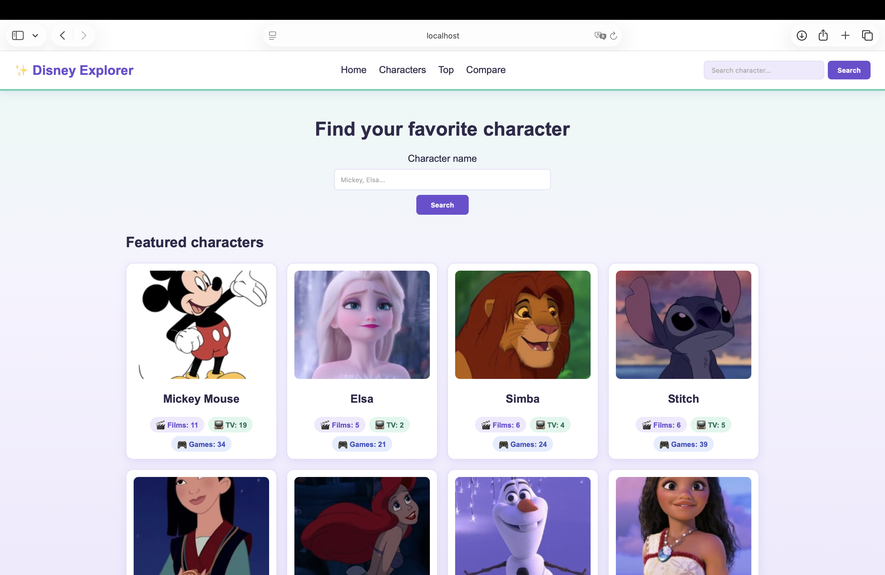
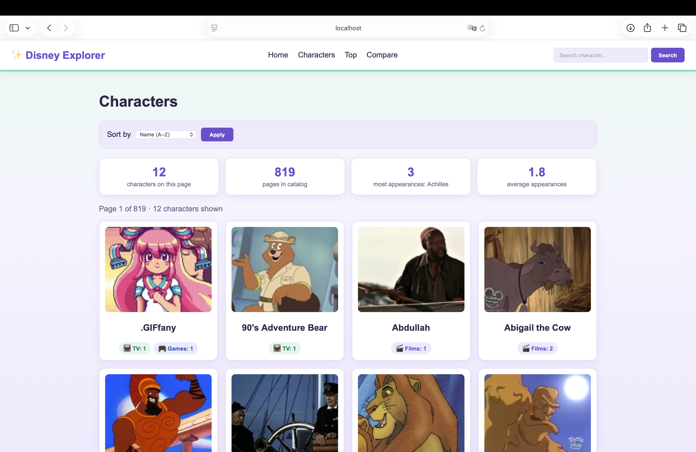
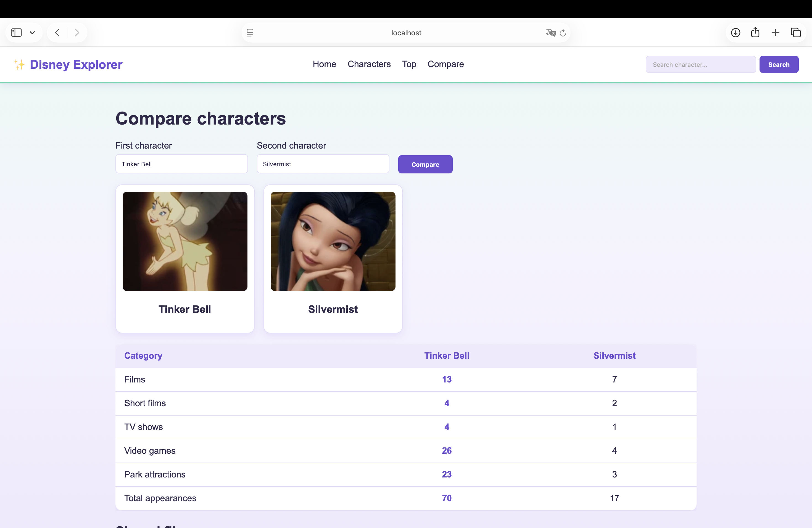
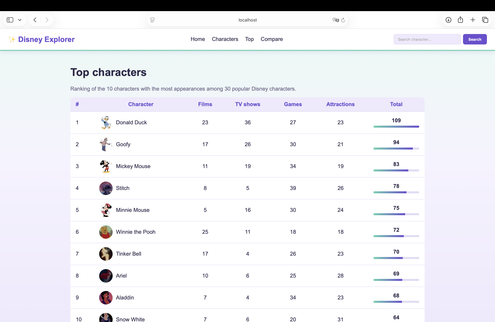

# Disney Explorer

## Project Description

Disney Explorer is a server-side web application built with Node.js and Express. It lets users explore Disney characters using data from the public Disney API: search for a character, browse a paginated catalog, open a details page, compare two characters, and see a ranking of the most popular characters by number of appearances.

## API Used

[Disney API](https://disneyapi.dev/) — free, no API key required.

Base URL: `https://api.disneyapi.dev`

Requests made with Axios (see `services/disneyService.js`):

| Request | Purpose |
|---|---|
| `GET /character?page=&pageSize=` | Catalog with pagination |
| `GET /character?name=` | Search and compare by name |
| `GET /character/:id` | Character details |

## Features

- **Home page:** featured characters shown as cards with tags (films, TV shows, video games).
- **Search:** search by name from the form on the home page or from the search box in the header (available on every page).
- **Catalog:** pagination, sorting (by name or by number of appearances), filter panel and a summary row (characters on page, pages, most appearances, average).
- **Character details:** counts per category and lists of films, TV shows, games, attractions, allies and enemies.
- **Compare:** two characters side by side with a winner in each category and shared films, TV shows and games.
- **Top characters:** ranking of the 10 characters with the most appearances among 30 popular characters, with progress bars.
- **Validation:** all user input is checked on the server before the API request.
- **Error handling:** friendly error page for invalid input, not found and API failures; technical details are logged to the console.
- **Responsive design:** works on desktop and mobile.

## Routes

| Method | Route | Description |
|---|---|---|
| GET | `/` | Home page |
| GET | `/characters?page=&sort=` | Character catalog |
| GET | `/character/:id` | Character details |
| GET | `/search?q=&page=` | Search results |
| GET | `/compare?a=&b=` | Compare two characters |
| GET | `/top` | Top characters ranking |

Forms use GET with query parameters.

## Project Structure

```text
disney-explorer/
├── app.js                  # entry point, middleware setup
├── routes/index.js         # route definitions
├── controllers/            # request handling logic
├── services/               # Axios calls to the Disney API
├── middleware/             # logger, validation, 404 and error handler
├── views/
│   ├── partials/           # header, footer, character card
│   └── pages/              # EJS pages
├── public/
│   ├── css/style.css
│   └── screenshots/
├── .env.example
├── .gitignore
├── package.json
└── README.md
```

## Installation and Setup

1. Clone the repository:

```bash
git clone https://github.com/nuraykaiyrbekova/disney-explorer.git
cd disney-explorer
```

2. Install dependencies:

```bash
npm install
```

3. Create a `.env` file in the project root (copy `.env.example`):

```env
PORT=3000
DISNEY_API_URL=https://api.disneyapi.dev
```

4. Start the application:

```bash
npm start
```

5. Open http://localhost:3000 in your browser.

## Screenshots

### Home page


### Character catalog


### Compare page


### Top characters


## Credits and AI Use

- Data: [Disney API](https://disneyapi.dev/).
- Code patterns were based on the official documentation of [Express](https://expressjs.com/), [Axios](https://axios-http.com/), [EJS](https://ejs.co/) and [dotenv](https://github.com/motdotla/dotenv).
- AI assistance: Claude (Anthropic) was used while developing this project. Details are in `AI_DECLARATION.md`.

## Author

Student name / ID: _write your name and ID here_

Course: VR 113153 Web Development II — Individual Project 